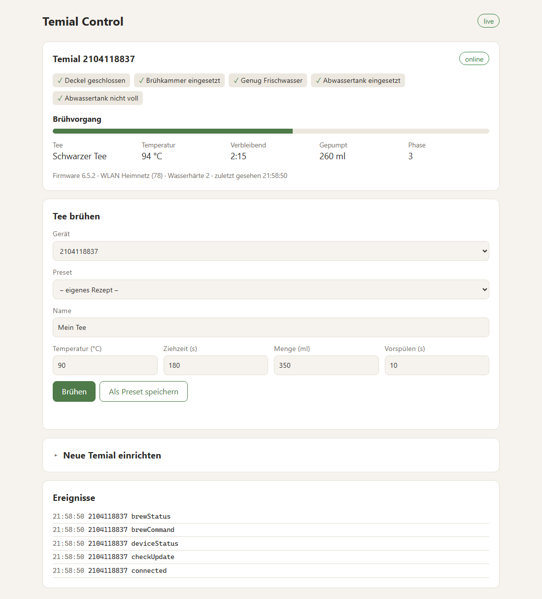
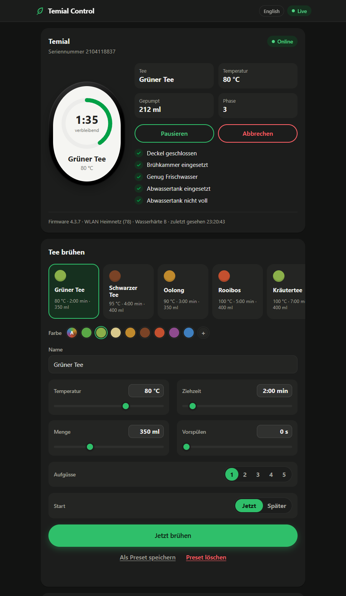
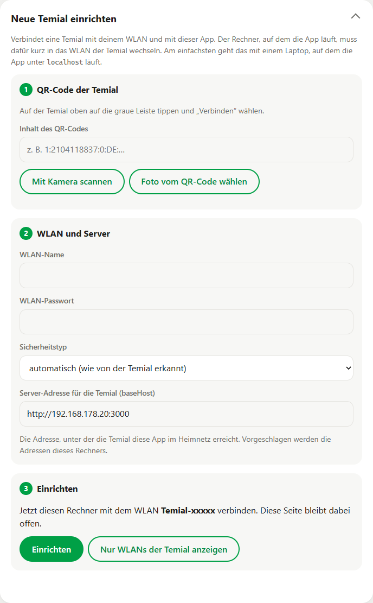
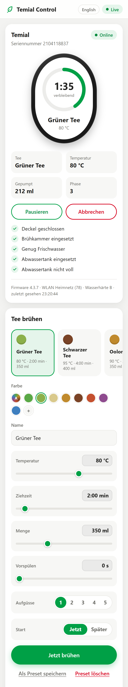

# Temial Control

Eigene Steuerzentrale für die **Vorwerk Temial**. Vorwerk hat die Cloud im Juli 2025 abgeschaltet. Diese App ersetzt sie lokal und baut dafür auf dem Protokoll auf, das das [Freemial-Projekt](https://freemial.github.io/) herausgefunden hat.

Die Temial verbindet sich per WebSocket direkt mit dieser App, sie ist also selbst der Freemial-kompatible Server. Dazu kommen:

- **Web-Dashboard**: Live-Status (Deckel, Brühkammer, Frischwasser, Abwassertank, WLAN, Firmware) und Fortschritt des Brühvorgangs
- **Tee brühen**: Name, Temperatur, Ziehzeit, Menge und Vorspülzeit frei wählbar
- **Presets**: gespeichert in `data/presets.json`, mit einigen Standard-Tees vorbelegt
- **Einrichtung neuer Geräte** direkt im Dashboard: QR-Code per Kamera oder Foto einlesen, WLAN wählen, fertig
- **REST-API und Server-Sent Events**, um eigene Automationen anzubinden (z. B. Home Assistant)

## Screenshots

<p>
  
  
</p>

<p>
  
  
</p>

Die Daten auf den Bildern stammen von einer simulierten Temial.

## Voraussetzungen

- Node.js **22.18 oder neuer**. Die TypeScript-Dateien laufen direkt, ohne Build-Schritt.
- Rechner und Temial im selben Netzwerk

## Starten

```bash
npm install
npm start
```

Beim Start gibt die App die Dashboard-URL und die `baseHost`-Adressen für die Temial aus, z. B. `http://192.168.178.20:3000`.

| Variable | Standard | Bedeutung |
|---|---|---|
| `PORT` | `3000` | Port für Dashboard, API und Geräte-WebSocket |
| `HOST` | `0.0.0.0` | Netzwerk-Interface. Muss für die Temial erreichbar sein. |
| `DATA_DIR` | `./data` | Speicherort der Presets |
| `APP_TOKEN` | – | Wenn gesetzt, verlangt `/api/*` diesen Token (Dashboard fragt einmal danach) |
| `BASE_HOST` | – | Adresse, die beim Start als `baseHost` angezeigt wird (sinnvoll in Docker) |

## Docker

Fertige Images für `amd64` und `arm64` (NAS, Raspberry Pi) baut GitHub Actions bei jedem Push nach `main` und legt sie unter `ghcr.io/megaheroxx/temial-control` ab. Tags: `latest`, `sha-<commit>` und bei Git-Tags `v1.2.3` auch `1.2.3` und `1.2`. Weil das Package privat ist, ist vorher ein Login mit einem Personal Access Token (Scope `read:packages`) nötig:

```bash
docker login ghcr.io -u megaheroxx
docker compose up -d
```

Die [docker-compose.yml](docker-compose.yml) zieht nur das fertige Image und braucht keinen Quellcode. Sie passt deshalb direkt für Portainer, Dockhand und ähnliche Tools: Registry `ghcr.io` mit Benutzer und Token anlegen, Compose-Datei als Stack einfügen.

Lokal selbst bauen:

```bash
docker build -t temial-control .
docker run -d --name temial-control -p 3000:3000 -v temial-data:/data --restart unless-stopped temial-control
```

Die Presets liegen im Volume `/data`. Als `baseHost` für die Temial gibst du die **IP des Docker-Hosts** an, nicht die Container-IP, z. B. `http://192.168.178.20:3000`.

## Temial mit der App verbinden

Einmalig pro Gerät, direkt im Dashboard unter **„Neue Temial einrichten“**:

1. Auf der Temial oben auf die graue Leiste tippen und **„Verbinden“** wählen. Es erscheint ein QR-Code.
2. QR-Code einlesen: **„Mit Kamera scannen“** (Webcam, nur unter `localhost` oder HTTPS), **„Foto vom QR-Code wählen“** oder den Text einfügen.
3. WLAN-Name und Passwort eintragen. Die Server-Adresse (`baseHost`) ist mit der Adresse dieses Rechners vorausgefüllt.
4. Den Rechner mit dem WLAN **`Temial-xxxxx`** verbinden (xxxxx = letzte 5 Stellen der Seriennummer, das Dashboard zeigt den Namen an). Die Seite bleibt offen.
5. **„Einrichten“** klicken. Die App verbindet sich mit der Temial, prüft die Seriennummer, sucht WLANs und überträgt die Einstellungen. Den Fortschritt zeigt sie Schritt für Schritt an.
6. Zurück ins normale WLAN wechseln. Die Temial meldet sich kurz darauf im Dashboard.

**Mit der Android-App geht es einfacher:** Dort richtet das Handy die Temial selbst ein (Abschnitt „Neue Temial einrichten“ → „Mit diesem Handy einrichten“ oder ⚙️ → „Neue Temial einrichten“). Der folgende Hinweis gilt nur für die Einrichtung über den Server.

**Wichtig:** Während der Einrichtung über den Server muss der Rechner, **auf dem die App läuft**, im WLAN der Temial sein. Nur dort ist das Gerät unter `192.168.1.1:4478` erreichbar. Läuft die App per Docker auf einem NAS oder Server am Kabel, richte die Temial einmal von einem Laptop aus ein (`npm start` oder Docker Desktop) und trage als Server-Adresse die des NAS ein. Danach verbindet sich die Temial direkt mit dem NAS.

Weitere Einschränkungen: WLAN-Name und Passwort dürfen keine Umlaute enthalten, weil das Freemial-Protokoll nur ASCII korrekt überträgt. Für versteckte WLANs den Sicherheitstyp von Hand wählen.

Alternativ geht die Einrichtung weiter über die offizielle [Freemial-CLI](https://www.npmjs.com/package/@freemial/cli):

```bash
npx -y @freemial/cli "<QR-Inhalt>" --ssid DeinWLAN --key DeinPasswort --baseHost http://192.168.178.20:3000
```

## API

Alle Routen liegen unter `/api`. Ist `APP_TOKEN` gesetzt, braucht jede Anfrage den Header `Authorization: Bearer <token>` oder für den Event-Stream `?token=<token>`.

| Methode | Pfad | Beschreibung |
|---|---|---|
| `GET` | `/api/devices` | Alle bekannten Geräte mit letztem Status |
| `POST` | `/api/devices/:serial/brew` | Brühen. Body: `{ name, temperature, duration, volume, preWashTime }` |
| `POST` | `/api/devices/:serial/control` | Laufendes Brühen steuern. Body: `{ "action": "cancel" }`, `"pause"` oder `"resume"` |
| `GET` | `/api/presets` | Presets auflisten |
| `POST` | `/api/presets` | Preset anlegen (gleicher Body wie beim Brühen) |
| `PATCH` | `/api/presets/:id` | Preset ändern, alle Felder optional: `name`, `temperature`, `duration`, `volume`, `preWashTime`, `color` (`null` = automatische Farbe) |
| `DELETE` | `/api/presets/:id` | Preset löschen |
| `GET` | `/api/config` | Erlaubte Wertebereiche |
| `GET` | `/api/events` | Server-Sent Events: `snapshot`, `device`, `log` |
| `GET` | `/api/setup` | Vorschläge für `baseHost`, Sicherheitstypen, ob eine Einrichtung läuft |
| `POST` | `/api/setup/scan` | WLANs anzeigen, die die Temial sieht. Body: `{ qr }` |
| `POST` | `/api/setup/configure` | Temial einrichten. Body: `{ qr, ssid, key, baseHost, securityType? }` |

Beispiel:

```bash
curl -X POST http://localhost:3000/api/devices/123456789/brew \
  -H "Content-Type: application/json" \
  -d '{"name":"Sencha","temperature":80,"duration":120,"volume":300,"preWashTime":0}'
```

## Android-App

Unter [android/](android/) liegt eine native Android-App (ab Android 8):

- zeigt das Dashboard deines Servers als App
- **Benachrichtigungen**, auch bei geschlossener App: „Dein Tee ist fertig“, „Frischwasser auffüllen“, „Abwassertank leeren“
- Fortschritt mit Restzeit in der Benachrichtigungsleiste, während die Temial brüht
- startet die Benachrichtigungen nach einem Neustart des Handys von selbst
- **richtet neue Temials direkt vom Handy ein:** QR-Code mit der Kamera scannen, Handy verbindet sich selbst mit dem WLAN der Temial (oder du verbindest dich von Hand) und überträgt Heim-WLAN und Server-Adresse. Dafür braucht es keinen Laptop, und der Server darf per Docker auf dem NAS laufen.

Die APK baut GitHub Actions bei jedem Release und hängt sie dort an (`temial-control-<version>.apk`). Installieren: APK aufs Handy laden, öffnen und die Installation aus dieser Quelle erlauben. Beim ersten Start fragt die App nach der Server-Adresse, z. B. `http://192.168.1.40:3010`, und optional nach dem `APP_TOKEN`.

Damit spätere Versionen als Update über die installierte App gehen, muss jede APK mit demselben Schlüssel signiert sein. Dafür braucht das Repo die Actions-Secrets `ANDROID_KEYSTORE_BASE64`, `ANDROID_KEYSTORE_PASSWORD` und `ANDROID_KEY_ALIAS`. Ohne sie signiert der Workflow mit einem Debug-Schlüssel, und Updates gehen nur nach einer Deinstallation.

Für die Benachrichtigungen hält die App eine dauerhafte Verbindung zum Server und zeigt dafür eine stille Status-Benachrichtigung. Das ist bei Android Pflicht. Die Funktion lässt sich in den App-Einstellungen abschalten.

Lokal bauen (JDK 17, Android SDK und Gradle 8.10 nötig): `cd android && gradle assembleRelease`

## Home Assistant

Unter [custom_components/temial_control/](custom_components/temial_control/) liegt eine Integration für Home Assistant. Sie wird über die Oberfläche eingerichtet und braucht kein YAML.

**Installation über HACS (empfohlen)**

[](https://my.home-assistant.io/redirect/hacs_repository/?owner=megaheroxx&repository=temial-control&category=integration)

Der Button öffnet HACS direkt in deinem Home Assistant. Alternativ von Hand: **HACS → ⋮ → Benutzerdefinierte Repositories → `https://github.com/megaheroxx/temial-control`, Typ „Integration“**. Danach „Temial Control“ herunterladen und Home Assistant neu starten. Über neue Versionen informiert HACS automatisch.

**Manuell:** Den Ordner `custom_components/temial_control` nach `/config/custom_components/temial_control` kopieren, z. B. mit dem File-Editor- oder Samba-Add-on, dann Home Assistant neu starten.

Danach unter **Einstellungen → Geräte & Dienste → Integration hinzufügen → „Temial Control“** die Adresse der App eingeben, z. B. `http://192.168.178.20:3000`, und falls gesetzt den `APP_TOKEN`.

**Was du bekommst**, pro Temial als eigenes Gerät:

| Typ | Entitäten |
|---|---|
| Sensoren | Restzeit, Brühtemperatur, Gepumpte Menge, Letzter Tee, dazu als Diagnose Brühphase, WLAN-Signal, Firmware und Wasserhärte |
| Binärsensoren | Verbunden, Brüht, Deckel geschlossen, Brühkammer eingesetzt, Frischwasser fehlt, Abwassertank voll, Abwassertank fehlt |
| Buttons | „… brühen“ für jedes Preset aus der App. Neue Presets erscheinen automatisch. |

Änderungen kommen sofort über den Event-Stream der App an. Zusätzlich fragt die Integration alle 30 Sekunden ab, falls der Stream abreißt.

**Aktionen für Automationen**

```yaml
# Preset aus der App
action: temial_control.brew_preset
data:
  device_id: <Temial auswählen>
  preset: Grüner Tee

# Freie Werte
action: temial_control.brew
data:
  device_id: <Temial auswählen>
  name: Sencha
  temperature: 80
  duration: 120
  volume: 300
  pre_wash_time: 0
```

Beispiel „Tee ist fertig“-Benachrichtigung:

```yaml
triggers:
  - trigger: state
    entity_id: binary_sensor.temial_2104118837_bruht
    from: "on"
    to: "off"
actions:
  - action: notify.notify
    data:
      message: Dein Tee ist fertig 🍵
```

Die Entity-IDs hängen von Seriennummer und Sprache ab. Du findest sie auf der Geräteseite.

## Sicherheit

- **Nicht ins Internet stellen.** Der Geräte-WebSocket hat keine Authentifizierung, so wie beim Original. Die Temial schickt keinen Token mit.
- Im Heimnetz mindestens `APP_TOKEN` setzen, wenn andere im Netz nicht brühen oder neue Geräte einrichten sollen.
- Das WLAN-Passwort aus der Einrichtung wird nur an die Temial weitergegeben und nirgends gespeichert.
- Kein Reverse-Proxy mit HTTP/2 davor: Die Temial liest HTTP-Header case-sensitiv und verbindet sich nicht, wenn sie kleingeschrieben ankommen.

## Bekannte Grenzen

- Was die Zahlenwerte `deviceState`, `activityState` und `phase` bedeuten, ist nicht dokumentiert. Das Dashboard zeigt sie roh an.
- Abbrechen, Pausieren und Fortsetzen nutzen den Befehl `remoteTea` der Original-App von Vorwerk. Reinigen und Entkalken sind weiterhin nicht bekannt.
- Die Wertebereiche in [src/validation.ts](src/validation.ts) sind vorsichtig gewählt. Die echten Grenzen des Geräts sind unbekannt.
- Der Gerätestatus liegt nur im Speicher und ist nach einem Neustart leer, bis sich die Temial wieder meldet.

## Entwicklung

```bash
npm run dev        # Neustart bei Dateiänderungen
npm test           # Tests mit simulierter Temial
npm run typecheck
```

Tests der Home-Assistant-Integration (Python 3.14):

```bash
pip install pytest-homeassistant-custom-component
pytest
```

| Datei | Inhalt |
|---|---|
| [src/protocol.ts](src/protocol.ts) | Nachrichtenformat der Temial (nach der Freemial-Referenz) |
| [src/device-hub.ts](src/device-hub.ts) | WebSocket-Server für Geräte, Zustand, Ereignislog |
| [src/app.ts](src/app.ts) | HTTP-Server, REST-API, SSE, Auslieferung des Dashboards |
| [src/presets.ts](src/presets.ts) | Preset-Speicher |
| [src/setup.ts](src/setup.ts) | Einrichtung über den Hotspot der Temial (mit `@freemial/connect`) |
| [public/](public/) | Dashboard (HTML/CSS/JS ohne Framework) |
| [custom_components/temial_control/](custom_components/temial_control/) | Home-Assistant-Integration (Python) |
| [tests_ha/](tests_ha/) | Tests der Integration gegen ein echtes Home Assistant |

## Lizenz

AGPL-3.0-or-later, wie das Freemial-Projekt, dessen Protokoll-Referenz hier übernommen wurde.
