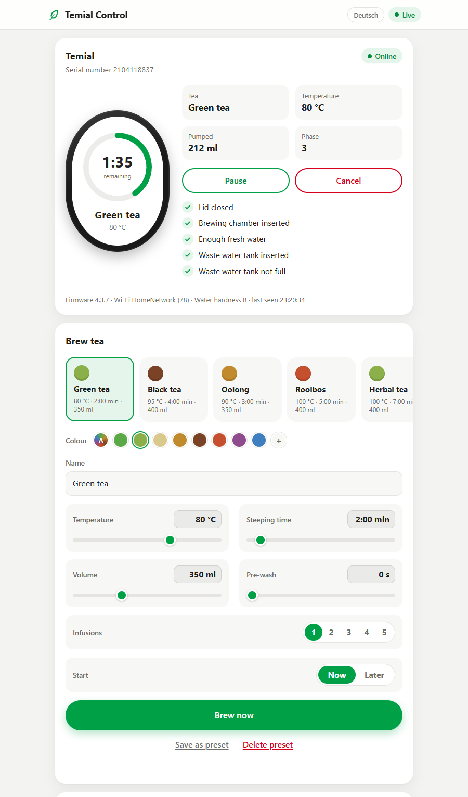
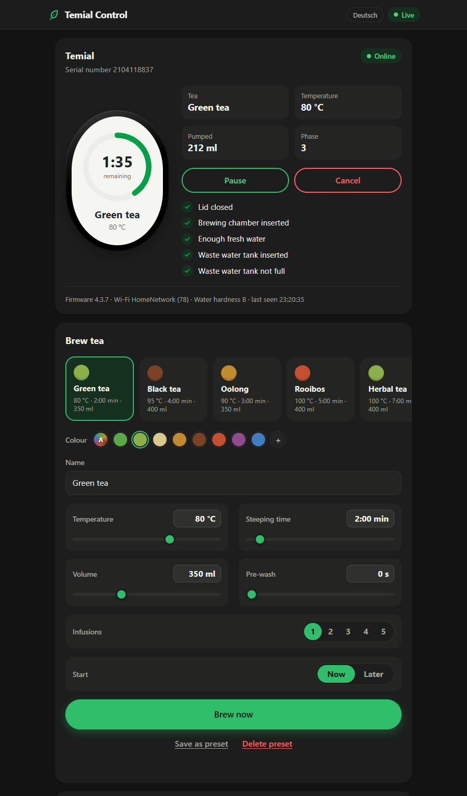
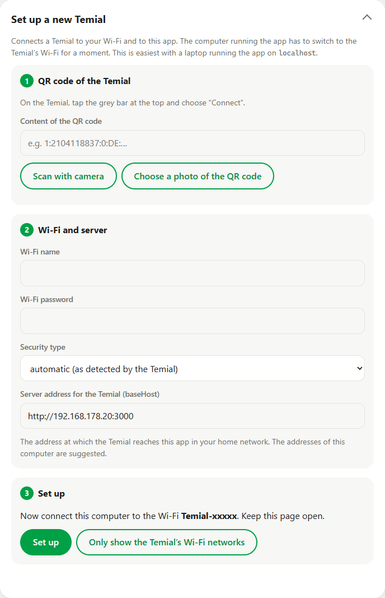
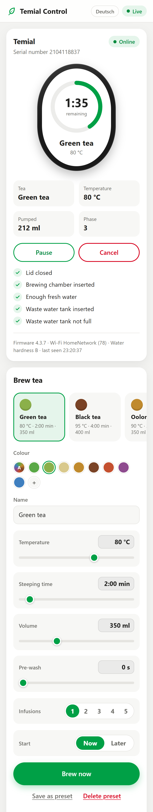

# Temial Control

**English** · [Deutsch](README.de.md) · Made with AI 🤖

A self-hosted control centre for the **Vorwerk Temial**. Vorwerk shut down the cloud in July 2025. This app replaces it locally, building on the protocol worked out by the [Freemial project](https://freemial.github.io/).

The Temial connects directly to this app over WebSocket, so the app itself is the Freemial-compatible server. On top of that you get:

- **Web dashboard**: live status (lid, brewing chamber, fresh water, waste water tank, Wi-Fi, firmware) and brewing progress
- **Brew tea**: freely choose name, temperature, steeping time, volume and pre-wash time
- **Multiple infusions**: up to 5 infusions of the same leaves, each with its own temperature and steeping time
- **Brew later**: pick a time and the Temial starts on its own, even if the server or phone is off in the meantime
- **Control brewing**: pause, resume, cancel
- **History and statistics**: cups per day and week, litres drunk, favourite teas; also counts teas started directly on the Temial
- **Presets**: stored in `data/presets.json`, pre-filled with a few default teas
- **Set up new devices** right in the dashboard: read the QR code via camera or photo, pick the Wi-Fi, done
- **REST API and server-sent events** to hook up your own automations (e.g. Home Assistant)
- **English and German** in the dashboard, Android app, server and Home Assistant integration

## Screenshots

<p>
  
  
</p>

<p>
  
  
</p>

The data in the pictures comes from a simulated Temial.

## Requirements

- Node.js **22.18 or newer**. The TypeScript files run directly, without a build step.
- Computer and Temial on the same network

## Getting started

```bash
npm install
npm start
```

On startup the app prints the dashboard URL and the `baseHost` addresses for the Temial, e.g. `http://192.168.178.20:3000`.

| Variable | Default | Meaning |
|---|---|---|
| `PORT` | `3000` | Port for dashboard, API and device WebSocket |
| `HOST` | `0.0.0.0` | Network interface. Must be reachable for the Temial. |
| `DATA_DIR` | `./data` | Where presets and history are stored |
| `APP_TOKEN` | – | If set, `/api/*` requires this token (the dashboard asks for it once) |
| `BASE_HOST` | – | Address shown as `baseHost` on startup (useful in Docker) |
| `APP_LANGUAGE` | `en` | Language of the console output, the default presets and API errors when the client sends no language (`en` or `de`) |

**Language:** The dashboard follows the browser's language and can be switched in the top right corner. The Android app follows the phone's language, the Home Assistant integration that of Home Assistant. API errors use the language from `X-Language` or `Accept-Language`.

## Docker

GitHub Actions builds ready-made images for `amd64` and `arm64` (NAS, Raspberry Pi) on every push to `main` and publishes them as `ghcr.io/megaheroxx/temial-control`. Tags: `latest`, `sha-<commit>`, and for Git tags `v1.2.3` also `1.2.3` and `1.2`. If the package is private, log in first with a personal access token (scope `read:packages`):

```bash
docker login ghcr.io -u megaheroxx
docker compose up -d
```

The [docker-compose.yml](docker-compose.yml) only pulls the ready-made image and needs no source code. It therefore works directly with Portainer, Dockhand and similar tools: add the registry `ghcr.io` with user and token, paste the compose file as a stack.

Build it yourself:

```bash
docker build -t temial-control .
docker run -d --name temial-control -p 3000:3000 -v temial-data:/data --restart unless-stopped temial-control
```

Presets and history live in the `/data` volume. As `baseHost` for the Temial use the **IP of the Docker host**, not the container IP, e.g. `http://192.168.178.20:3000`.

## Connecting a Temial to the app

Once per device, right in the dashboard under **"Set up a new Temial"**:

1. On the Temial, tap the grey bar at the top and choose **"Connect"**. A QR code appears.
2. Read the QR code: **"Scan with camera"** (webcam, only on `localhost` or HTTPS), **"Choose a photo of the QR code"** or paste the text.
3. Enter the Wi-Fi name and password. The server address (`baseHost`) is pre-filled with this computer's address.
4. Connect the computer to the Wi-Fi **`Temial-xxxxx`** (xxxxx = last 5 digits of the serial number; the dashboard shows the name). Keep the page open.
5. Click **"Set up"**. The app connects to the Temial, checks the serial number, scans for Wi-Fi networks and sends the settings, showing the progress step by step.
6. Switch back to your normal Wi-Fi. The Temial shows up in the dashboard shortly after.

**It is easier with the Android app:** there the phone sets up the Temial itself ("Set up a new Temial" section → "Set up with this phone", or ⚙️ → "Set up a new Temial"). The following note only applies to setup through the server.

**Important:** During setup through the server, the computer **running the app** must be in the Temial's Wi-Fi. Only there is the device reachable at `192.168.1.1:4478`. If the app runs in Docker on a wired NAS or server, set up the Temial once from a laptop (`npm start` or Docker Desktop) and enter the NAS address as the server address. Afterwards the Temial connects directly to the NAS.

Further limitations: Wi-Fi name and password must not contain umlauts or other non-ASCII characters, because the Freemial protocol only transfers ASCII correctly. For hidden networks, choose the security type manually.

Alternatively, setup still works with the official [Freemial CLI](https://www.npmjs.com/package/@freemial/cli):

```bash
npx -y @freemial/cli "<QR content>" --ssid YourWifi --key YourPassword --baseHost http://192.168.178.20:3000
```

## API

All routes live under `/api`. If `APP_TOKEN` is set, every request needs the header `Authorization: Bearer <token>`, or `?token=<token>` for the event stream.

| Method | Path | Description |
|---|---|---|
| `GET` | `/api/devices` | All known devices with their latest status |
| `POST` | `/api/devices/:serial/brew` | Brew. Body: `{ name, temperature, duration, volume, preWashTime }`, optionally `infusions: [{ temperature, duration }, …]` for further infusions (up to 5 in total) and `startInSeconds` for a timer (default 10, at most 86400). With `presetId` (and optionally `color`) the Temial shows the preset's name instead of "Manual tea" |
| `POST` | `/api/devices/:serial/infusion` | Multiple infusions: `{ "action": "next" }` starts the next one, `{ "action": "done" }` finishes the session |
| `POST` | `/api/devices/:serial/control` | Control a running brew. Body: `{ "action": "cancel" }`, `"pause"` or `"resume"` |
| `GET` | `/api/stats` | Statistics: cups today, this week, in total, litres, last 7 days, favourite teas |
| `GET` | `/api/history?limit=50` | History of brews, newest first |
| `GET` | `/api/presets` | List presets |
| `POST` | `/api/presets` | Create a preset (same body as for brewing) |
| `PATCH` | `/api/presets/:id` | Change a preset, all fields optional: `name`, `temperature`, `duration`, `volume`, `preWashTime`, `color` (`null` = automatic colour) |
| `DELETE` | `/api/presets/:id` | Delete a preset |
| `GET` | `/api/config` | Allowed value ranges |
| `GET` | `/api/events` | Server-sent events: `snapshot`, `device`, `log` |
| `GET` | `/api/setup` | Suggestions for `baseHost`, security types, whether a setup is running |
| `POST` | `/api/setup/scan` | Show the Wi-Fi networks the Temial sees. Body: `{ qr }` |
| `POST` | `/api/setup/configure` | Set up a Temial. Body: `{ qr, ssid, key, baseHost, securityType? }` |

Example:

```bash
curl -X POST http://localhost:3000/api/devices/123456789/brew \
  -H "Content-Type: application/json" \
  -d '{"name":"Sencha","temperature":80,"duration":120,"volume":300,"preWashTime":0}'
```

## Android app

[android/](android/) contains a native Android app (Android 8 and newer):

- shows your server's dashboard as an app
- **notifications**, even with the app closed: "Your tea is ready", "Refill fresh water", "Empty the waste water tank"
- progress with remaining time in the notification shade while the Temial is brewing
- restarts the notifications on its own after the phone reboots
- **sets up new Temials right from the phone:** scan the QR code with the camera, the phone connects to the Temial's Wi-Fi by itself (or you connect manually) and sends your home Wi-Fi and server address. No laptop needed, and the server can stay in Docker on the NAS.

GitHub Actions builds the APK for every release and attaches it there (`temial-control-<version>.apk`). To install: download the APK to the phone, open it and allow installing from this source. On first start the app asks for the server address, e.g. `http://192.168.1.40:3010`, and optionally for the `APP_TOKEN`.

So that later versions install as updates over the existing app, every APK must be signed with the same key. For this the repo needs the Actions secrets `ANDROID_KEYSTORE_BASE64`, `ANDROID_KEYSTORE_PASSWORD` and `ANDROID_KEY_ALIAS`. Without them the workflow signs with a debug key, and updates only work after uninstalling.

For notifications the app keeps a persistent connection to the server and shows a silent status notification for it, which Android requires. The feature can be turned off in the app settings.

Build locally (requires JDK 17, Android SDK and Gradle 8.10): `cd android && gradle assembleRelease`

## Home Assistant

[custom_components/temial_control/](custom_components/temial_control/) contains an integration for Home Assistant. It is set up through the UI and needs no YAML.

**Installation via HACS (recommended)**

[](https://my.home-assistant.io/redirect/hacs_repository/?owner=megaheroxx&repository=temial-control&category=integration)

The button opens HACS directly in your Home Assistant. Or manually: **HACS → ⋮ → Custom repositories → `https://github.com/megaheroxx/temial-control`, type "Integration"**. Then download "Temial Control" and restart Home Assistant. HACS notifies you about new versions automatically.

**Manually:** copy the folder `custom_components/temial_control` to `/config/custom_components/temial_control`, e.g. with the File editor or Samba add-on, then restart Home Assistant.

Then go to **Settings → Devices & services → Add integration → "Temial Control"**, enter the app's address, e.g. `http://192.168.178.20:3000`, and the `APP_TOKEN` if set.

**What you get**, one device per Temial:

| Type | Entities |
|---|---|
| Sensors | Remaining time, brewing temperature, pumped volume, last tea, plus diagnostic brewing phase, Wi-Fi signal, firmware and water hardness |
| Binary sensors | Connected, brewing, lid closed, brewing chamber inserted, fresh water missing, waste water tank full, waste water tank missing |
| Buttons | "Brew …" for every preset from the app. New presets appear automatically. |

Changes arrive instantly via the app's event stream. In addition, the integration polls every 30 seconds in case the stream drops.

**Actions for automations**

```yaml
# Preset from the app
action: temial_control.brew_preset
data:
  device_id: <select Temial>
  preset: Green tea
  start_in_minutes: 30  # optional timer

# Free values
action: temial_control.brew
data:
  device_id: <select Temial>
  name: Sencha
  temperature: 80
  duration: 120
  volume: 300
  pre_wash_time: 0
```

Example "tea is ready" notification:

```yaml
triggers:
  - trigger: state
    entity_id: binary_sensor.temial_2104118837_brewing
    from: "on"
    to: "off"
actions:
  - action: notify.notify
    data:
      message: Your tea is ready 🍵
```

Entity IDs depend on the serial number and language. You can find them on the device page.

## Security

- **Do not expose it to the internet.** The device WebSocket has no authentication, just like the original. The Temial sends no token.
- On your home network, at least set `APP_TOKEN` if others on the network should not brew or set up new devices.
- The Wi-Fi password from the setup is only passed on to the Temial and never stored.
- No reverse proxy with HTTP/2 in front: the Temial reads HTTP headers case-sensitively and does not connect if they arrive in lower case.

## Known limitations

- What the numeric values `deviceState`, `activityState` and `phase` mean is undocumented. The dashboard shows them raw.
- Cancel, pause and resume use the `remoteTea` command of Vorwerk's original app. Cleaning and descaling are still unknown.
- Showing the preset's name on the Temial (`teaId` -30) comes from the original app and still has to be confirmed on a real device.
- The value ranges in [src/validation.ts](src/validation.ts) are chosen conservatively. The device's real limits are unknown.
- Device status is kept in memory only and is empty after a restart until the Temial reports again.

## Development

```bash
npm run dev        # restart on file changes
npm test           # tests with a simulated Temial
npm run typecheck
```

Tests for the Home Assistant integration (Python 3.14):

```bash
pip install pytest-homeassistant-custom-component
pytest
```

| File | Contents |
|---|---|
| [src/protocol.ts](src/protocol.ts) | Temial message format (following the Freemial reference) |
| [src/device-hub.ts](src/device-hub.ts) | WebSocket server for devices, state, event log |
| [src/app.ts](src/app.ts) | HTTP server, REST API, SSE, serving the dashboard |
| [src/i18n.ts](src/i18n.ts) | Server messages in English and German |
| [src/presets.ts](src/presets.ts) | Preset store |
| [src/history.ts](src/history.ts) | Brew history and statistics |
| [src/setup.ts](src/setup.ts) | Setup via the Temial's hotspot (with `@freemial/connect`) |
| [public/](public/) | Dashboard (HTML/CSS/JS without a framework), texts in [public/i18n.js](public/i18n.js) |
| [android/](android/) | Android app (Kotlin), texts in `res/values` and `res/values-de` |
| [custom_components/temial_control/](custom_components/temial_control/) | Home Assistant integration (Python) |
| [tests_ha/](tests_ha/) | Integration tests against a real Home Assistant |

## License

AGPL-3.0-or-later, like the Freemial project whose protocol reference was adopted here.
